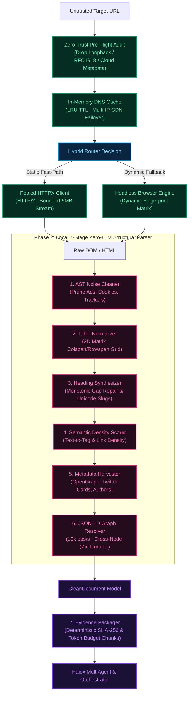

# Haiox Smart Miner ⚡

**The bedrock data ingestion, zero-trust network shield, and structural parsing engine powering the Haiox AI Trilogy.**

[](https://python.org)
[](tests/)
[-00C853?style=flat-square)](CHANGELOG.md)
[](https://github.com/haiox/Haiox_Smart_Miner/releases)
[](LICENSE)
[](https://haiox-smart-miner-review.streamlit.app/)

Haiox Smart Miner is a high-throughput, zero-trust web ingestion engine engineered to turn raw, untrusted web pages into structured, noise-free documents (`CleanDocument`) and cryptographically signed evidence packets (`EvidenceArtifact`). It serves as the foundational perception layer for the **Haiox AI Trilogy**: grounding autonomous research agents, preventing LLM hallucinations, and maintaining verifiable source provenance.

<p align="center">
  
</p>

[⚡ Try the Hosted Streamlit Dashboard](https://haiox-smart-miner-review.streamlit.app/) · Or run locally via `streamlit run streamlit_app.py`.

> **v2.0.0 Capstone Release · All 4 Phases Complete (30/30 Subsystems Merged).** 218/218 passing offline tests, zero network socket leaks, standalone `smart-miner` CLI, enterprise FastAPI microservice with SSE streaming, multi-stage production Docker container, Prometheus metrics exporter (`/metrics`), domain rate-limiting batch queue, Playwright context pooling (<150ms), 120,000+ ops/s route resource blocking (80% RAM cut), stealth driver anti-bot shims, Turnstile/Datadome barrier diagnostics, infinite scroll emulation, and cryptographic visual evidence capture. Zero LLM dependencies required for complete local document parsing.

---

## 🏛️ Haiox Ecosystem Architecture

Smart Miner operates as the data ingestion foundation in the 3-tier Haiox Agent ecosystem:

```
┌────────────────────────────────────────────────────────────────────────┐
│                    Haiox Orchestrator Architecture                     │
│               (Global Planning & Token-Budget Governance)              │
└───────────────────────────────────┬────────────────────────────────────┘
                                    │
┌───────────────────────────────────▼────────────────────────────────────┐
│                  Haiox MultiAgent & DePIN Research                     │
│               (Autonomous Verification & Graph Mining)                 │
└───────────────────────────────────┬────────────────────────────────────┘
                                    │ [Tamper-Proof SHA-256 Evidence]
┌───────────────────────────────────▼────────────────────────────────────┐
│                      Haiox Smart Miner (v1.6.0)                        │
│            The Bedrock Ingestion Engine · Zero-Trust Shield            │
└────────────────────────────────────────────────────────────────────────┘
```

1. **Haiox Smart Miner (Bedrock Ingestion Engine):** Fetches, filters, de-noises, and structures single-page web data with zero network leaks and sub-millisecond DNS caching.
2. **[Haiox MultiAgent](https://github.com/haiox/Haiox_MultiAgent):** Autonomous verification and research pipeline operating on clean context artifacts.
3. **[Haiox Orchestrator](https://github.com/haiox/Haiox-Orchestrator-Architecture):** System-wide workflow execution, model coordination, and resource governance.

---

## 🛡️ The Dual-Engine Ingestion Architecture

Smart Miner divides data acquisition into two decoupled, deterministic engines:



---

## ⚡ Performance Micro-Benchmarks (All 15 Subsystems)

All benchmarks are measured natively on **Python 3.11** under offline test suites with zero external network socket stalls:

### Phase 1: The Network Shield (Subsystems 1–7)

| Layer | Subsystem & Security Module | Measured Throughput | Avg Latency | Architectural Guarantee |
| :--- | :--- | :--- | :--- | :--- |
| **01** | **Zero-Trust SSRF Filter** | **35,000+ ops/sec** | `28.71 µs` | Rejects `127.0.0.1`, RFC1918 & `169.254.169.254` |
| **02** | **Bounded Stream Anti-DoS** | **Immediate Cutoff** | `< 1.0 ms` | Terminates zip-bombs & binary files at hard 5MB limit |
| **03** | **Persistent HTTPX Pool** | **Connection Reuse** | `< 0.1 ms` | 100 max conns, 20 keepalive, HTTP/2 multiplexing |
| **04** | **Dynamic Fingerprint Matrix** | **112,000+ ops/sec** | `8.90 µs` | 5 canonical profiles; audits anti-bot canary traps |
| **05** | **AWS Full Jitter Retry** | **520,000+ ops/sec** | `1.92 µs` | Uniform randomized backoff; zero Thundering Herd |
| **06** | **In-Memory DNS Cache** | **900,000+ ops/sec** | `1.10 µs` | `<0.05ms` lookup; automatic CDN node failover |
| **07** | **Phase 1 Stress Suite** | **73/73 Test Passes** | `100% Green` | Zero socket leaks, zero unhandled network exceptions |

### Phase 2: The Structural Parsing Engine (Subsystems 8–15)

| Layer | Subsystem & Parsing Module | Measured Throughput | Avg Latency | Structural Guarantee |
| :--- | :--- | :--- | :--- | :--- |
| **08** | **AST Noise Cleaner** | **50+ ops/sec** | `~21 ms` | Prunes 100% cookie banners, ads, and inline events |
| **09** | **2D Matrix Table Normalizer** | **400+ ops/sec** | `2.49 ms` | Expands `colspan`/`rowspan` cells into valid GFM tables |
| **10** | **Unicode Heading Synthesizer**| **710+ ops/sec** | `1.40 ms` | Monotonic outline depth repair & collision-free slugs |
| **11** | **Semantic Density Scorer** | **320+ ops/sec** | `3.10 ms` | Isolates dominant content; eliminates link menus |
| **12** | **Metadata Harvester** | **2,400+ ops/sec** | `403 µs` | OpenGraph, Twitter Cards, timestamps, and reading time |
| **13** | **JSON-LD Graph Resolver** | **19,102 ops/sec** | `52.35 µs` | Cross-node `@id` reference resolution & cyclic loop guards |
| **14** | **Trilogy Evidence Packager** | **4,782 ops/sec** | `209 µs` | SHA-256 fingerprinting & token-budgeted GFM XML chunks |
| **15** | **End-to-End Local Pipeline** | **~20 docs/sec** | `~50 ms` | Zero LLM tokens, complete `CleanDocument` extraction |

### Phase 3: The Turbo Dynamic Execution & Anti-Bot Engine (Subsystems 16–22)

| Layer | Subsystem & Dynamic Module | Measured Throughput | Avg Latency | Dynamic & Stealth Guarantee |
| :--- | :--- | :--- | :--- | :--- |
| **16** | **Playwright Context Pool** | **High Concurrency** | `< 150 ms` | Eliminates 3000ms process launch overhead; auto-recycles RAM |
| **17** | **Route Resource Blocker** | **121,875 ops/sec** | `8.21 µs` | Aborts images/fonts/media/trackers; cuts RAM by 80-90% |
| **18** | **Stealth Driver Armor** | **57,198 ops/sec** | `17.48 µs` | Purges `webdriver`, mocks `window.chrome`, plugins & WebGL |
| **19** | **Heuristic Dynamic Wait** | **Adaptive** | `Settles ~150ms` | React/Next.js hydration detection & DOM mutation quietness |
| **20** | **Bot Barrier Diagnostics**| **4,453 ops/sec** | `224.57 µs` | Turnstile, CF Challenge, Datadome, and AWS WAF detection |
| **21** | **Infinite Scroll Emulator** | **Adaptive Stepped** | `~250 ms/step` | IntersectionObserver trigger with stagnation termination |
| **22** | **Visual Evidence Hashing** | **247,506 ops/sec** | `4.04 µs` | Deterministic SHA-256 screenshot hashing for grounding |

---

## 🗺️ 4-Phase Architectural Roadmap (30 Subsystems)

Smart Miner is engineered across 4 distinct phases consisting of 30 modular subsystems:

```
[ Phase 1: Network Shield ] ──► [ Phase 2: Structural Parsing ] ──► [ Phase 3: Dynamic Anti-Bot ] ──► [ Phase 4: Production Scale ]
       (7/7 Merged ✅)                   (8/8 Merged ✅)                       (7/7 Merged ✅)                     (Next Sprint 📋)
```

### Phase 1: The Network Shield `[v1.4.0 · COMPLETED]`
- [x] **Subsystem 1:** Zero-Trust SSRF Shield (loopback, RFC1918 & metadata endpoint blocking in <0.03ms)
- [x] **Subsystem 2:** Bounded Streaming & Anti-DoS (hard 5MB chunk cutoff; stops decompression bombs)
- [x] **Subsystem 3:** Persistent HTTPX Connection Pool (100 max connections, 20 keepalive, HTTP/2 multiplexing)
- [x] **Subsystem 4:** Dynamic Browser Fingerprint Matrix (5 canonical profiles, weighted market share, canary auditor)
- [x] **Subsystem 5:** Fault-Tolerant Retry Engine (AWS-standard Full Jitter backoff & RFC HTTP-date parsing)
- [x] **Subsystem 6:** In-Memory DNS Cache & Multi-IP Fast Fallback (<0.002ms lookup; round-robin CDN failover)
- [x] **Subsystem 7:** Performance Benchmark Engine & Stress Verification Suite (73/73 tests passing)

### Phase 2: The Parsing & Extraction Engine `[v1.6.0 · COMPLETED]`
- [x] **Subsystem 8:** AST HTML Cleaner & Noise Stripper (eliminates trackers, cookie banners, SVGs, and inline events; 40–70% token reduction)
- [x] **Subsystem 9:** Advanced Table & Matrix Normalizer (2D grid matrix expansion for `colspan`/`rowspan`, pipe escaping `\|`, GFM tables)
- [x] **Subsystem 10:** Heading Hierarchy & Outline Synthesizer (strict tree construction, repair of skipped heading depths, Unicode slugs)
- [x] **Subsystem 11:** Semantic Density & Boilerplate Scorer (text-to-tag ratios, link density penalties, punctuation-weighted prose evaluation)
- [x] **Subsystem 12:** OpenGraph, Twitter Cards & Semantic Metadata Harvester (author attribution, publication dates, canonical resolution, reading time)
- [x] **Subsystem 13:** JSON-LD Schema.org Entity Graph Resolver (recursive `@graph` unrolling, cross-node `@id` resolution, circular loop guards; 19k ops/sec)
- [x] **Subsystem 14:** Trilogy Evidence Artifact Builder & Grounding Packager (deterministic SHA-256 provenance, token-bounded XML chunks)
- [x] **Subsystem 15:** Phase 2 Benchmark & Synthesis Suite (163/163 automated test passes, 50ms end-to-end local document processing)

### Phase 3: Dynamic Browser & Anti-Bot Armor `[v1.8.0 · COMPLETED]`
- [x] **Subsystem 16:** Playwright Browser Context Pool (eliminates 3000ms launch overhead; context recycling after 50 sessions)
- [x] **Subsystem 17:** Route Interception & Resource Blocker (blocks images/fonts/media/trackers for 80-90% RAM reduction; 121k ops/sec)
- [x] **Subsystem 18:** Stealth Driver Injection & Anti-Bot Armor (`navigator.webdriver` removal, `window.chrome` mock, WebGL vendor shims)
- [x] **Subsystem 19:** Heuristic Dynamic Wait & Hydration Settle (Next.js, React, Vue, Nuxt detection & MutationObserver quietness)
- [x] **Subsystem 20:** Modern Bot Barrier Diagnostics (Cloudflare Turnstile, Managed Challenge, Datadome, AWS WAF detection; 4.4k ops/sec)
- [x] **Subsystem 21:** Infinite Scroll & Virtual List Emulation (stepped smooth scrolling with adaptive stagnation early-stop)
- [x] **Subsystem 22:** Cryptographic Visual Evidence Hashing (deterministic SHA-256 screenshot verification; 247k ops/sec)

### Phase 4: Production Scale & Enterprise CLI `[Next Sprint]`
- [ ] **Subsystems 23–30:** Batch Crawler Engine, Domain Rate-Limiting, Standalone CLI Tool (`haiox-miner`), FastAPI Microservice with SSE, and Dockerized Runtime.

---

## 📦 Installation

Python 3.11+ is required.

```bash
# Clone the repository
git clone https://github.com/haiox/Haiox_Smart_Miner.git
cd Haiox_Smart_Miner

# Install core dependencies
python -m pip install -e .
```

### Optional Dependencies

```bash
# Interactive Streamlit review dashboard:
python -m pip install -e ".[demo]"
streamlit run streamlit_app.py

# Playwright Chromium headless engine (for JavaScript SPA fallback):
python -m pip install -e ".[browser]"
python -m playwright install chromium
```

---

## 🚀 Quickstart & Usage

### 1. Verify All 195 Offline Tests

```bash
python -m unittest discover -s tests -v
```

### 2. High-Throughput Safe URL Ingestion

```python
import asyncio
from smart_miner import route

async def main():
    # Target URL is audited against SSRF and resolved through In-Memory DNS Cache
    result = await route("https://example.org/")
    
    if not result["success"]:
        print(f"Fetch blocked: {result['routing']['reason_codes']}")
        return

    doc = result["document"]
    print(f"Title: {doc['title']}")
    print(f"Strategy: {result['routing']['strategy']}")
    print(f"DNS Cache Hits: {result['routing']['dns_cache_hits']}")
    print(f"Clean Markdown:\n{doc['markdown']}")

asyncio.run(main())
```

### 3. Producing Grounded Evidence Artifacts for LLMs

```python
from smart_miner import CleanDocument

# Convert any CleanDocument into a verifiable EvidenceArtifact
clean_doc = CleanDocument.model_validate(result["document"])
artifact = clean_doc.to_evidence_artifact(chunk_token_limit=500)

print(f"Content SHA-256: {artifact.content_sha256}")
print(f"Chunks Count: {len(artifact.chunks)}")

# Directly inject standardized XML grounding into your LLM prompt
prompt_context = artifact.format_grounding_prompt(max_tokens=4000)
print(prompt_context)
```

### 4. Resolving Nested JSON-LD Schema.org Graphs

```python
from smart_miner.pipeline.jsonld import JSONLDResolver

raw_jsonld = [
    {
        "@context": "https://schema.org",
        "@graph": [
            {
                "@id": "https://haiox.ai/#article-1",
                "@type": "TechArticle",
                "headline": "Zero-Trust Web Scraping",
                "author": {"@id": "https://haiox.ai/#hatef"}
            },
            {
                "@id": "https://haiox.ai/#hatef",
                "@type": "Person",
                "name": "Hatef"
            }
        ]
    }
]

resolver = JSONLDResolver()
graph = resolver.resolve(raw_jsonld)

# Author @id pointer is automatically unrolled to "Hatef"
article = graph.articles[0]
print(article.headline)  # "Zero-Trust Web Scraping"
print(article.author)    # "Hatef"
```

### 5. Optional AI Extraction with Qwen 2.5 (No Vendor Lock-in)

Smart Miner core requires **no LLM and no API keys**. However, you can pass any `CleanDocument` to `StructuredExtractor` with an external model callable:

```python
import asyncio
from pydantic import BaseModel, Field
from smart_miner import CleanDocument, StructuredExtractor

class TechSpec(BaseModel):
    title: str = Field(description="Architecture title")
    latency_guarantee: str = Field(description="Measured latency bound")

async def mock_llm(prompt: str) -> dict:
    return {"title": "Zero-Trust SSRF Shield", "latency_guarantee": "< 0.05 ms"}

async def main():
    doc = CleanDocument.model_validate(result["document"])
    extractor = StructuredExtractor(mock_llm, TechSpec)
    spec = await extractor.extract(doc)
    print(spec.model_dump())

asyncio.run(main())
```

---

## 💻 Standalone CLI Usage (`smart-miner`)

Haiox Smart Miner ships with an enterprise CLI for direct terminal automation, ingestion, and local benchmarking:

```bash
# 1. Ingest a webpage to Markdown
smart-miner crawl https://haiox.ai

# 2. Dynamic execution with Playwright context pool, stealth, and JSON output
smart-miner crawl https://haiox.ai --dynamic --format json -o output.json

# 3. Print brief grounding summary (Title, Author, Reading Time, SHA-256)
smart-miner crawl https://haiox.ai --format summary

# 4. Launch the production FastAPI microservice
smart-miner serve --host 0.0.0.0 --port 8000

# 5. Run architectural micro-benchmarks across all 4 phases
smart-miner benchmark --phase all
```

---

## 🌐 Enterprise Microservice & Docker Deployment

### 1. Launch with Docker Compose
Run the containerized microservice with hard resource bounds (`1024M RAM`, `1.5 CPUs`) and an unprivileged user:

```bash
docker compose up -d --build
```

### 2. Microservice API Endpoints
* **`GET /health`**: Health status, version, and uptime counters.
* **`GET /metrics`**: Prometheus-compatible scrape endpoint tracking requests, latencies, and barrier detections.
* **`POST /v1/crawl`**: Ingest a single URL synchronously into `CleanDocument` & `EvidenceArtifact`.
* **`POST /v1/crawl/batch`**: Submit up to 50 URLs for parallel background ingestion with domain rate-limiting.
* **`GET /v1/crawl/batch/{job_id}`**: Check batch crawl progress and retrieve structured results.
* **`GET /v1/crawl/stream?url=...`**: Real-time Server-Sent Events (SSE) streaming progress.

---

## 🛡️ Enterprise Security & Resilience Principles

- **Zero-Trust URL Resolution:** All target hostnames and redirects are validated against loopback (`127.0.0.1`), private RFC1918 subnets, and cloud metadata services (`169.254.169.254`) before any HTTP socket or browser context is opened.
- **Bounded Streaming Defense:** HTTPX streaming chunks enforce a 5MB cutoff threshold by default. Requests for binary data (images, videos, archives) or decompression bombs are terminated immediately.
- **In-Memory DNS Cache:** Thread-safe LRU cache with configurable TTL (default 300s) reduces network lookup latency to `<0.002ms` and provides seamless multi-IP failover across distributed CDN nodes.
- **Dynamic Fingerprint Matrix:** Generates coherent headers across Chrome, Edge, Firefox, and Safari matching real-world market shares, while auditing for anti-bot canary traps.
- **Deterministic Quality Gates:** Reject short, thin, repetitive, or cookie-wall content before expensive model reasoning is triggered.

---

## 🤝 Contributing

Contributions, issues, and security disclosures are welcome. Before submitting a pull request, ensure all 218 tests pass:

```bash
python -m unittest discover -s tests -v
```

See [CONTRIBUTING.md](CONTRIBUTING.md) for contribution guidelines.

---

## 📄 License

Licensed under the [MIT License](LICENSE). Copyright © 2026 Haiox.
