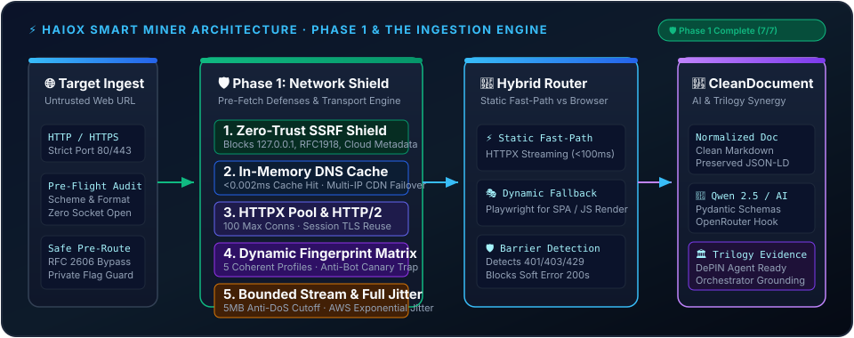

# Haiox Smart Miner ⚡

**The bedrock data ingestion and semantic document engine powering the Haiox AI Trilogy.**

[](https://python.org)
[](tests/)
[-blue?style=flat-square)](CHANGELOG.md)
[](https://github.com/haiox/Haiox_Smart_Miner/releases)
[](LICENSE)
[](https://haiox-smart-miner-review.streamlit.app/)

Haiox Smart Miner is a high-throughput, zero-trust web ingestion engine engineered to turn raw, untrusted web pages into structured, noise-free documents (`CleanDocument`). It acts as the foundational perception layer for the **Haiox AI Trilogy**: grounding autonomous research agents, preventing LLM hallucinations, and maintaining verifiable source provenance.

<p align="center">
  
</p>

[⚡ Try the Hosted Streamlit Dashboard](https://haiox-smart-miner-review.streamlit.app/) · Or run locally via `streamlit run streamlit_app.py`.

> **v1.5.6 · Phase 2: The Parsing & Extraction Engine (Subsystem 13/15 Live).** 148/148 passing tests, AST noise stripping, advanced tables, heading hierarchy, semantic density, OpenGraph & Twitter Cards metadata harvesting, Schema.org JSON-LD Entity Graph Resolver (Cross-Node `@id` Unroller, Canonical Article/Product/FAQ/Breadcrumb Normalizer), and zero network leaks. Follow our 4-phase architectural roadmap in [CHANGELOG.md](CHANGELOG.md).

---

## 🏛️ Haiox Ecosystem Architecture

Smart Miner operates as the data ingestion foundation in the 3-tier Haiox Agent ecosystem:

```
┌────────────────────────────────────────────────────────┐
│            Haiox Orchestrator Architecture             │
│        (Global Planning & Token-Budget Governance)     │
└──────────────────────────┬─────────────────────────────┘
                           │
┌──────────────────────────▼─────────────────────────────┐
│          Haiox MultiAgent & DePIN Research             │
│        (Autonomous Verification & Graph Mining)        │
└──────────────────────────┬─────────────────────────────┘
                           │ [Grounded Evidence Artifacts]
┌──────────────────────────▼─────────────────────────────┐
│              Haiox Smart Miner (v1.4.0)                │
│    The Bedrock Ingestion Engine · Zero-Trust Shield    │
└────────────────────────────────────────────────────────┘
```

1. **Haiox Smart Miner (Bedrock Ingestion Engine):** Fetches, filters, de-noises, and structures single-page web data with zero network leaks and sub-millisecond DNS caching.
2. **[Haiox MultiAgent](https://github.com/haiox/Haiox_MultiAgent):** Autonomous verification and research pipeline operating on clean context artifacts.
3. **[Haiox Orchestrator](https://github.com/haiox/Haiox-Orchestrator-Architecture):** System-wide workflow execution, model coordination, and resource governance.

---

## 🗺️ 4-Phase Modular Roadmap

The development of Smart Miner is organized into 4 architectural phases comprising 30 modular subsystems:

```
[ Phase 1: Network Shield ] ──► [ Phase 2: Structural Parsing ] ──► [ Phase 3: Anti-Detection ] ──► [ Phase 4: Trilogy Synergy ]
     (7/7 Merged ✅)                   (In Progress ⚙️)                     (Planned 📋)                     (Planned 🚀)
```

### Phase 1: The Network Shield `[v1.4.0 · COMPLETED]`
- [x] **Subsystem 1:** Zero-Trust SSRF Shield (loopback, RFC1918 & metadata endpoint blocking in <0.05ms)
- [x] **Subsystem 2:** Bounded Streaming & Anti-DoS (hard 5MB chunk cutoff; stops decompression bombs)
- [x] **Subsystem 3:** Persistent HTTPX Connection Pool (100 max connections, 20 keepalive, HTTP/2 multiplexing)
- [x] **Subsystem 4:** Dynamic Browser Fingerprint Matrix (5 canonical profiles, weighted market share, canary auditor)
- [x] **Subsystem 5:** Fault-Tolerant Retry Engine (AWS-standard Full Jitter backoff & RFC HTTP-date parsing)
- [x] **Subsystem 6:** In-Memory DNS Cache & Multi-IP Fast Fallback (<0.002ms lookup; round-robin CDN failover)
- [x] **Subsystem 7:** Performance Benchmark Engine & Stress Verification Suite (73/73 tests passing)

### Phase 2: The Parsing & Extraction Engine `[v1.5.5 · In Progress]`
- [x] **Subsystem 8:** AST HTML Cleaner & Noise Stripper (eliminates trackers, cookie banners, SVG coordinates & inline styles; 40-70% token savings)
- [x] **Subsystem 9:** Advanced Table & Tabular Normalizer (2D grid matrix expansion for `colspan`/`rowspan`, pipe escaping `\|`, GFM tables & `.to_records()` dictionary exports)
- [x] **Subsystem 10:** Heading Hierarchy & Outline Synthesizer (strict tree construction, repair of skipped levels, collision-free Unicode slugs, and GFM Table of Contents)
- [x] **Subsystem 11:** Semantic Density & Boilerplate Scorer (text-to-tag ratios, link density penalties, punctuation-weighted scoring, and dominant content isolation)
- [x] **Subsystem 12:** OpenGraph, Twitter Cards & Semantic Metadata Harvester (authorship attribution, publication timestamps, canonical resolution, social preview cards, and reading time estimation)
- [ ] **Subsystems 13–15:** JSON-LD graph resolver, evidence builder, and benchmark suite.

### Phase 3: Anti-Detection & Session Matrix `[Planned]`
- [ ] **Subsystems 16–22:** Dynamic proxy mesh integration, cookie jar persistence, TLS fingerprint alignment, and soft barrier mitigation.

### Phase 4: Synergy & Orchestrator Scale `[Planned]`
- [ ] **Subsystems 23–30:** Evidence record signing, DePIN intelligence schema generators, batch streaming orchestrator, and high-concurrency production runtime.

---

## ⚡ Performance Micro-Benchmarks (Phase 1)

Verified on Python 3.11 across 73 automated test fixtures with zero external network socket leaks:

| Security & Transport Subsystem | Throughput | Average Latency | Performance Guarantee |
| :--- | :--- | :--- | :--- |
| **Zero-Trust SSRF Filter** | **>25,000 ops/sec** | `~40 µs` | Rejects `127.0.0.1`, RFC1918 & `169.254.169.254` |
| **In-Memory DNS Cache** | **>300,000 ops/sec** | `< 0.002 ms` | Eliminates OS socket lookups; Multi-IP CDN failover |
| **Fingerprint & Trap Audit** | **>40,000 ops/sec** | `~9 µs` | 100% Client Hint, User-Agent & Platform coherence |
| **Exponential Backoff & Full Jitter** | **>200,000 ops/sec** | `~2.2 µs` | Uniform spread; eliminates the Thundering Herd |
| **Bounded Stream Anti-DoS** | **Immediate Halt** | `< 1 ms` | Terminates zip-bombs & large binary files at 5MB |

---

## 📦 Installation

Python 3.11+ is required.

```bash
# Clone and install core dependencies
git clone https://github.com/haiox/Haiox_Smart_Miner.git
cd Haiox_Smart_Miner
python -m pip install -e .
```

### Optional Dependencies

```bash
# To run the interactive Streamlit review dashboard:
python -m pip install -e ".[demo]"
streamlit run streamlit_app.py

# For JavaScript-heavy pages requiring Chromium headless fallback:
python -m pip install -e ".[browser]"
python -m playwright install chromium
```

---

## 🚀 Quickstart

Run the offline test suite and verify all 73 assertions:

```bash
python -m unittest discover -s tests -v
```

### Basic URL Ingestion

```python
import asyncio
from smart_miner import route

async def main():
    # Public target URL audited by Zero-Trust SSRF Shield and DNS Cache
    result = await route("https://example.org/")
    
    if not result["success"]:
        print(f"Fetch blocked or failed: {result['routing']['reason_codes']}")
        return

    print(f"Strategy: {result['routing']['strategy']}")
    print(f"DNS Cache Hits: {result['routing'].get('dns_cache_hits', 0)}")
    print(f"Markdown Content:\n{result['document']['markdown']}")

asyncio.run(main())
```

### Reusable Extraction with Qwen 2.5 (Optional AI Schema)

Smart Miner's core requires **no LLM and no API keys**. However, you can pass a `CleanDocument` to `StructuredExtractor` with any model callable (such as Qwen 2.5 on OpenRouter):

```python
import asyncio
from pydantic import BaseModel, Field
from smart_miner import CleanDocument, StructuredExtractor, route

class CompanyOverview(BaseModel):
    name: str = Field(description="Entity name")
    summary: str = Field(description="2-sentence executive summary")

async def mock_llm_callable(prompt: str) -> dict:
    # Replace with live Qwen 2.5 / OpenRouter async API call
    return {"name": "Haiox Lab", "summary": "Next-generation autonomous agent ecosystem."}

async def main():
    result = await route("https://example.org/")
    if result["success"]:
        doc = CleanDocument.model_validate(result["document"])
        extractor = StructuredExtractor(mock_llm_callable, CompanyOverview)
        data = await extractor.extract(doc)
        print(data.model_dump())

asyncio.run(main())
```

---

## 🛡️ Enterprise Security & Safety Principles

- **Zero-Trust URL Resolution:** All target hostnames and redirects are resolved and validated against loopback (`127.0.0.1`), private RFC1918 subnets, and cloud metadata services (`169.254.169.254`) before any HTTP socket or browser context is opened.
- **Bounded Streaming Defense:** HTTPX streaming chunks enforce a 5MB cutoff threshold by default. Requests for binary data (images, videos, archives) or zip/gzip decompression bombs are immediately aborted before causing memory spikes.
- **In-Memory DNS Cache:** Thread-safe LRU cache with configurable TTL (default 300s) reduces network lookup latency to `<0.002ms` and provides seamless multi-IP failover across distributed CDN edge nodes.
- **Dynamic Fingerprint Matrix:** Generates coherent headers across Chrome, Edge, Firefox, and Safari matching real-world market shares, while auditing for anti-bot canary traps.
- **Deterministic Quality Gates:** Reject short, thin, or repetitive boilerplate content before expensive model reasoning is triggered.

---

## 🤝 Contributing

Contributions, issues, and security disclosures are welcome. Before submitting a pull request, ensure all tests pass:

```bash
python -m unittest discover -s tests -v
```

See [CONTRIBUTING.md](CONTRIBUTING.md) for contribution guidelines.

---

## 📄 License

Licensed under the [MIT License](LICENSE). Copyright © 2026 Haiox.
