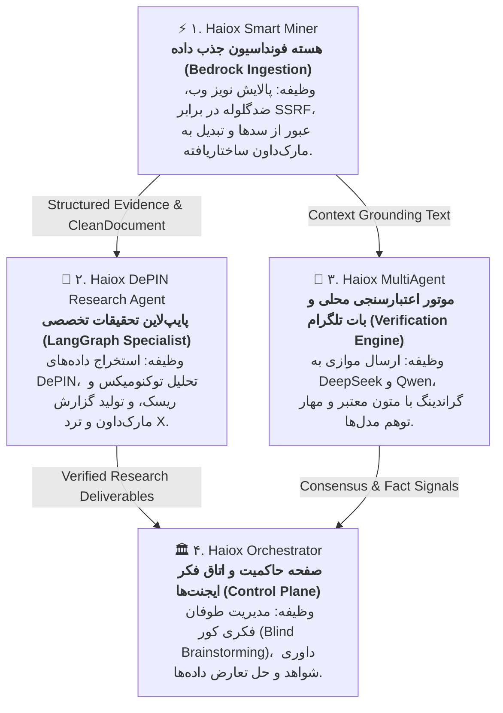

# سند راهبردی اکوسیستم سه‌گانه هایوکس و نقشه راه کلان توسعه ⚡
**Haiox Agentic Ecosystem: Master Roadmap & Sequential Timeline**  
*طراحی‌شده جهت بارگذاری و تحلیل در NotebookLM*

---

## ۱. مانیفست و معماری کلان اکوسیستم هایوکس (Ecosystem Overview)

اکوسیستم هایوکس یک ساختار چندعامله، ماژولار و مستقل از ارائه‌دهنده (Provider-Independent) است که با هدف حذف توهم مدل‌ها (Hallucination)، پالایش ناپایداری‌های وب و ایجاد یک اتاق فکر حاکمیتی برای سیستم‌های هوش مصنوعی طراحی شده است.

این اکوسیستم از ۴ پروژه به‌هم‌پیوسته تشکیل شده است:

---

## ۲. اصل «انجین فدا» و ریشه درخت وابستگی (The Dependency Root)

### چرا پروژه‌های دیگر نباید همزمان با Smart Miner استارت بخورند؟
در سیستم‌های توزیع‌شده چندعامله، **قانون ریشه درخت (Root Node Principle)** حاکم است:
1. **وابستگی مستقیم سورس‌کد:** پروژه `DePIN Research Agent` دارای ماژولی به نام `tools/smart_miner_adapter.py` است؛ یعنی تا زمانی که خروجی Smart Miner دارای اصالت، امنیت و ساختار پایدار نباشد، گراف LangGraph دیتای کثیف یا ساختار شکننده دریافت می‌کند.
2. **ورودی بدون نویز برای مهار توهم:** پروژه `MultiAgent` برای مقایسه استدلال مدل‌های DeepSeek و Qwen به متنی نیاز دارد که تگ‌های جاوااسکریپت، بنرهای کوکی و نویزهای تبلیغاتی از آن کاملاً زدوده شده باشد.
3. **تولید شواهد معتبر (Evidence Records):** ارکستراتور در فاز Evidence Cross-check بر روی شواهد مستند با هش SHA-256 تکیه می‌کند که مستقیماً باید توسط Smart Miner صادر شود.

> **نتیجه استراتژیک:** با رساندن Smart Miner به بلوغ زیرساختی، نیمی از مسیر پروژه‌های بعدی به‌طور خودکار طی می‌شود.

---

## ۳. جدول زمانی کلان و توالی توسعه (Master Timeline)

توسعه در قالب شیفت‌های شبانه متمرکز (ساعت ۰۱:۳۰ تا ۰۲:۳۰ بامداد) به صورت متوالی و بدون شکستن تمرکز پیش می‌رود:

| فاز کلان | دوره زمانی | پروژه هدف | دستاورد کلیدی محصولی (Deliverable) | وضعیت |
| :--- | :--- | :--- | :--- | :---: |
| **ایستگاه اول** | ۳۰ شب متوالی (ماه جاری) | **⚡ Haiox Smart Miner** | موتور ضدگلوله جذب داده، مهار SSRF، استخر مرورگر، استخراج جداول و متادیتا، داشبورد Streamlit و خروجی Evidence Pack. | **در حال اجرا** (شب ۱ انجام شد) |
| **ایستگاه دوم** | ۱۰ شب متمرکز (پس از بلوغ هسته) | **🔬 Haiox DePIN Research Agent** | اتصال پایپ‌لاین LangGraph به Smart Miner v2.0، اتوماسیون انتشار در توییتر و گزارش‌های مارک‌داون بدون نیاز به Postgres محلی. | برنامه‌ریزی‌شده |
| **ایستگاه سوم** | ۱۴ شب متمرکز | **🤖 Haiox MultiAgent** | پیاده‌سازی موتور ارزیابی تناقض و فکت‌چکینگ واقعی، اتصال دیتابیس برداری (Vector DB) و استریمینگ زنده در تلگرام. | برنامه‌ریزی‌شده |
| **ایستگاه چهارم** | ۱۴ شب متمرکز | **🏛️ Haiox Orchestrator** | انتشار نسخه Open-Core با FastAPI و داشبورد زنده جهت نمایش عمومی اتاق فکر ایجنت‌ها و حل تعارضات. | برنامه‌ریزی‌شده |

---

## ۴. نقطه عطف انتقال و «پل زدن» (The Bridge Transition)

لازم نیست ۳۰ شب Smart Miner تمام شود تا پروژه‌های دیگر لمس شوند؛ از **هفته سوم (شب‌های ۱۵ تا ۲۱)** نقطه عطف انتقال آغاز می‌شود:

* **شب‌های ۱ تا ۱۴ (ایزولاسیون کامل هسته):**
  - ضدگلوله شدن ترانسپورت (Zero-Trust SSRF).
  - استریم امن با سقف بایت مجاز (Anti-Bomb).
  - استخر کانتکست Playwright (سرعت رندر زیر ۳۰۰ میلی‌ثانیه).
  - استخراج هوشمند چگالی متن و فرمت‌دهی جداول.
* **شب‌های ۱۵ تا ۲۴ (تولید ساختار شواهد):**
  - صدور شیپ داده استاندارد `EvidenceRecord` با متادیتای غنی و تخمین توکن‌های LLM.
* **شب‌های ۲۵ تا ۲۸ (پل زدن زنده):**
  - **شب ۲۵:** اتصال متد `to_evidence_record()` به معماری `Haiox-Orchestrator`.
  - **شب ۲۶:** اتصال پایپ‌لاین گراندینگ به `Haiox_MultiAgent`.
  - **شب ۲۷:** تست یکپارچگی میدانی با گراف تحقیقاتی `Haiox_DePIN_Research_Agent`.

---

## ۵. نقشه راه اختصاصی ۳ پروژه بعدی پس از بلوغ هسته

### ۱. نقشه راه ۱۰ روزه Haiox DePIN Research Agent
* **شب ۱:** بازنویسی `smart_miner_adapter.py` جهت اتصال مستقیم به نسخه جدید Smart Miner.
* **شب ۲:** ایجاد لایه ذخیره‌سازی سبک با SQLite (امکان اجرای ۱۰۰٪ محلی بدون وابستگی به سرور دیتابیس خارجی).
* **شب ۳:** بهینه‌سازی گره توکنومیکس (`tokenomics_agent.py`) با پرامپت‌های تفکیک‌شده شواهد و تحلیل ریسک توزیع توکن.
* **شب ۴:** ارتقای گره اعتبارسنجی ادعاها (`verification_agent.py`) با تطبیق مستقیم متن وایت‌پیپر.
* **شب ۵:** موتور کارخانه محتوا (`content_factory.py`) جهت تولید تمیز گزارش‌های مارک‌داون سازگار با گیت‌هاب.
* **شب ۶:** اتوماسیون تولید ترد تخصصی برای X (توییتر) با فرمت استاندارد زیر ۲۸۰ کاراکتر.
* **شب ۷:** کشینگ هوشمند ادعاها و نتایج تحقیقات جهت کاهش ۹۰ درصدی هزینه‌های فراخوانی مدل‌ها.
* **شب ۸:** سوییت تست‌های آفلاین با داده‌های موک از ۴ پروژه نمونه (Grass, DAWN, Bless, Teneo).
* **شب ۹:** مستندسازی تصویری ساختار گراف، بازنویسی README و به‌روزرسانی نمونه گزارش‌ها.
* **شب ۱۰:** دمو، انتشار نسخه جدید و اعلام عمومی روی توییتر `@haioxlab`.

---

### ۲. نقشه راه ۱۴ روزه Haiox MultiAgent
* **شب ۱:** معماری موتور فکت‌چکینگ واقعی (`verification_engine.py`) به جای نمایش صرف پاسخ‌ها.
* **شب ۲:** الگوریتم امتیازدهی به اجماع مدل‌ها (Consensus Scoring با وزن‌دهی به خروجی DeepSeek و Qwen).
* **شب ۳:** آشکارساز تناقضات معنایی میان پاسخ دو مدل (Contradiction & Disagreement Detector).
* **شب ۴:** اتصال خودکار دیتای گراندینگ به اسناد پاکسازی‌شده `CleanDocument` استخراج‌شده از Smart Miner.
* **شب ۵:** پیاده‌سازی سیستم ریتریوال سریع با دیتابیس برداری سبک محلی (ChromaDB / Qdrant).
* **شب ۶:** استریمینگ زنده پاسخ‌ها در محیط تلگرام با پروتکل Asyncio (ارسال چانک به چانک متن).
* **شب ۷:** طراحی کیبوردهای شیشه‌ای (Inline Keyboards) برای درخواست منابع، درصد قطعیت و نمایش استدلال مجزای مدل‌ها.
* **شب ۸:** ایزولاسیون خطا و سوییچ خودکار در صورت قطعی API یکی از مدل‌ها (Graceful Degradation).
* **شب ۹:** سیستم لاگینگ ساختاریافته بدون افشای پیام‌های کاربران و تاریخچه مکالمات.
* **شب ۱۰:** شبیه‌ساز تست‌های آفلاین ربات بدون نیاز به اینترنت و بدون اتصال به سرور تلگرام.
* **شب ۱۱:** بهینه‌سازی مصرف حافظه و مدیریت نشست‌ها (Session Management).
* **شب ۱۲:** کانتینریزه کردن کامل ربات با Docker و فایل `docker-compose.yml`.
* **شب ۱۳:** بازنویسی کامل مستندات فنی و ارائه ویدیو یا گیف تعاملی در README.
* **شب ۱۴:** انتشار رسمی v2.0 روی گیت‌هاب.

---

### ۳. نقشه راه ۱۴ روزه Haiox Orchestrator Architecture
* **شب ۱:** پیاده‌سازی هسته عمومی ماشین وضعیت (State Machine) شامل ۴ فاز قطعی: `Idle` ➔ `BlindBrainstorming` ➔ `EvidenceCrosscheck` ➔ `OrchestratorSynthesis`.
* **شب ۲:** پروتکل ایزولاسیون کامل ورکرها در فاز اول (Blind Brainstorming جهت حذف لنگر انداختن ذهنی مدل‌ها روی هم).
* **شب ۳:** موتور داوری و ارزیابی شواهد با پذیرش ساختار داده `EvidenceRecord`.
* **شب ۴:** سیستم سنتز نهایی و اعلام صریح تعارضات باقی‌مانده میان متخصصان.
* **شب ۵:** توسعه لایه ترانسپورت سبک FastAPI با استریم رویدادهای زنده (Server-Sent Events - SSE).
* **شب ۶:** طراحی رویدادهای نرمال‌شده (Normalized Event Bus) برای انتقال به فرانت‌اند.
* **شب ۷:** پیاده‌سازی کلاینت بصری در Streamlit جهت مشاهده زنده بحث ایجنت‌ها توسط کاربر.
* **شب ۸:** کنترل دسترسی و سیاست‌های بازنمایی اطلاعات بر اساس مرز فازها (Governed Visibility).
* **شب ۹:** مکانیزم لغو امن ران‌ها و کنترل سقف بودجه توکن‌ها (Token & Time Budgeting).
* **شب ۱۰:** ایجاد شبیه‌ساز سناریوهای حل اختلاف بدون نیاز به اتصال به مدل‌های تجاری گران.
* **شب ۱۱:** تست‌های یکپارچگی End-to-End خط‌لوله حاکمیت.
* **شب ۱۲:** تنظیمات استقرار با داکر و ایمیج کم‌حجم.
* **شب ۱۳:** بازنویسی وایت‌پیپر و ادغام دیاگرام‌های Mermaid در README.
* **شب ۱۴:** رونمایی رسمی از دمو اوپن‌کور در توییتر و کامیونیتی هوش مصنوعی.

---

## ۶. مرزبندی عمومی و خصوصی (Public Open-Core vs. Private IP)

برای حفظ امنیت بیزینس و پایداری مزیت رقابتی، مرزها شفاف است:
* **عمومی (Open-Core):** کدهای ترانسپورت، هسته تمیزکننده، ماشین وضعیت، کدهای ارتباط تلگرام، گراف LangGraph و دموی استریم‌لیت.
* **خصوصی (Proprietary SaaS / Operations):** کلیدهای API اختصاصی، پرامپت‌های استراتژیک محرمانه، دیتای زنده مشتریان، الگوریتم‌های اختصاصی ارزش‌گذاری و ربات فریلنسری **Freelancer Sniper**.

---

## ۷. روتین روزانه و شبانه تیم (The Winning Rhythm)
* **روزها (Daytime):** تمرکز ۱۰۰٪ روی بیزینس، فریلنسری و نقدینگی از طریق اسنایپ پروژه‌ها با استناد به پورتفلیوی لایو گیت‌هاب.
* **شب‌ها (Nightly 01:30–02:30 AM):** ۶۰ دقیقه تمرکز مهندسی، تست، کامیت، پوش و انتشار لاگ توسعه در اکانت **`@haioxlab`** با هشتگ `#BuildInPublic`.
